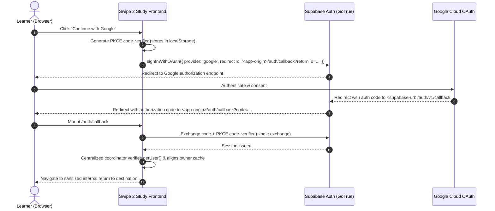

# Google Sign-In Staging & Configuration Guide

This guide details the prerequisites, dashboard configurations, URL endpoints, and environment variables required to activate Google OAuth in a staging environment.

> [!IMPORTANT]
> **Zero Secrets in Frontend / Git**: Google OAuth Client Secrets belong strictly within the Supabase Dashboard provider configuration. Never expose secrets in `VITE_` variables, client code, or repository commits.
> The frontend feature flag `VITE_GOOGLE_AUTH_ENABLED` must remain disabled until all provider settings and allowlists are verified.

---

## Architecture Overview



---

## 1. Google Cloud OAuth Client Configuration

Configure the OAuth 2.0 Client in [Google Cloud Console](https://console.cloud.google.com/apis/credentials):

1. **OAuth Consent Screen**:
   - **User Type**: External (or Internal if restricted to your workspace).
   - **Scopes**: Request ONLY basic identity scopes (`openid`, `https://www.googleapis.com/auth/userinfo.email`, `https://www.googleapis.com/auth/userinfo.profile`). Do not request Google Drive, Calendar, or other privileged scopes.
2. **Authorized JavaScript Origins**:
   - Add your Supabase project origin:
     `https://<project-ref>.supabase.co`
3. **Authorized Redirect URIs**:
   - Add the Supabase Auth provider callback endpoint:
     `https://<project-ref>.supabase.co/auth/v1/callback`
   - *(Note: Do NOT place your app origin here; Google returns authorization to the Supabase provider callback URI above).*
4. **Obtain Credentials**:
   - Client ID: e.g. `<client-id>.apps.googleusercontent.com`
   - Client Secret: (Keep secure; only paste into Supabase Dashboard).

---

## 2. Supabase Google Provider Configuration

Configure the Google provider in [Supabase Dashboard](https://supabase.com/dashboard) under **Authentication -> Providers -> Google**:

1. **Toggle**: Enable Google provider.
2. **Client ID**: Paste the Client ID from Google Cloud Console.
3. **Client Secret**: Paste the Client Secret from Google Cloud Console.
4. **Callback URL (for reference)**:
   - Supabase displays: `https://<project-ref>.supabase.co/auth/v1/callback`.
   - Verify this exactly matches the Authorized Redirect URI entered in Google Cloud Console.
5. Save provider settings.

---

## 3. App Callback URL & Supabase Redirect Allowlist

In Supabase Dashboard under **Authentication -> URL Configuration**:

1. **Site URL**:
   - Set to the primary staging origin:
     `https://<staging-app-domain>` (or `http://localhost:5173` for local development).
2. **Redirect URLs (Allowlist)**:
   - Add all authorized frontend callback URLs where learners may complete sign-in:
     - Staging: `https://<staging-app-domain>/auth/callback**`
     - Local Dev: `http://localhost:5173/auth/callback**`
     - Custom Preview / PR environments (if applicable): `https://<preview-domain>/auth/callback**`
   - *Security note: Supabase rejects redirects to origins not in this allowlist.*

---

## 4. Frontend Feature Flag & Environment Variables

The frontend guards Google sign-in readiness behind an explicit flag. In `.env.staging` (or hosting platform environment settings):

```ini
# Required for all Supabase communication
VITE_SUPABASE_URL=https://<project-ref>.supabase.co
VITE_SUPABASE_PUBLISHABLE_KEY=sb_publishable_...

# Google Sign-In Gate: set to 'true' ONLY after steps 1-3 are complete
VITE_GOOGLE_AUTH_ENABLED=true
```

- When `VITE_GOOGLE_AUTH_ENABLED` is missing or `false`:
  - No Google button or divider is displayed on `/login` or `/signup`.
  - Email/password authentication and guest learning remain fully active.
- When `VITE_GOOGLE_AUTH_ENABLED=true` AND Supabase is properly configured:
  - Accessible "Continue with Google" buttons are exposed on `/login` and `/signup`.
  - Duplicate clicks are prevented, and errors are surfaced actionably.

---

## 5. PKCE Same-Browser & Same-Origin Constraints

- **Single-Device / Single-Profile Flow**:
  Supabase uses PKCE (`flowType: 'pkce'`). The initiation step generates a cryptographically random `code_verifier` stored in browser `localStorage`.
  The learner MUST complete the OAuth flow in the exact same browser profile and origin. If the OAuth callback is opened in a different browser, incognito window, or distinct origin, verification will fail closed with `pkce_verifier_not_found`.
- **Account Deletion Boundary**:
  Password reauthentication for account deletion remains strictly enforced on the server. Google-only accounts cannot delete themselves until provider reauthentication is implemented in a future update; the system honesty warns the user.

